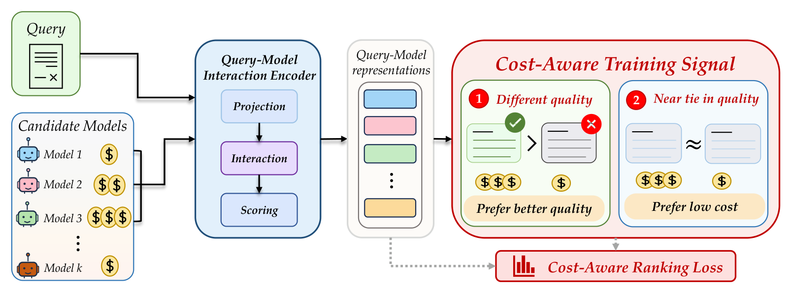
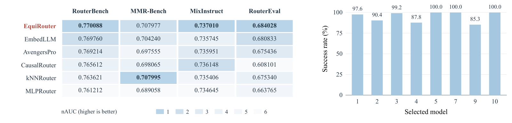

<div align="center">

# EquiRouter

### When LLM Routers Overpay: The Cost of Strong-Model Preference

**Guannan Lai · Long Chen · Han-Jia Ye**<br>
Nanjing University · The Hong Kong University of Science and Technology

[](https://openreview.net/forum?id=v2DOrFK8Wp)
[](LICENSE)

**Train query-dependent rankings with utility preferences and cost-aware tie-breaking.**

</div>

## Overview

LLM routing should reserve expensive models for queries that need them. Yet a
looser budget can lead routers to select premium models even when cheaper
feasible candidates provide comparable utility. We call this **strong-model
over-selection under loose budgets**.

Our analysis separates two ingredients: quality-equivalent alternatives create
opportunities to overpay, and a persistent preference for costly models gives
those choices a direction. Symmetric uncertainty alone does not explain that
direction; increasing the budget exposes the preference by making premium
candidates feasible.

**EquiRouter** is trained to rank candidates by utility and favor lower-cost
models within a task-dependent utility tolerance.

### Contributions

- **Diagnose overpayment:** distinguish quality errors from avoidable spending among quality-equivalent candidates.
- **Explain its direction:** identify the interaction between equivalent-utility opportunities, persistent model preferences, and budget exposure.
- **Align learning with decisions:** combine query–model interactions with selective cost-aware ranking across text, multimodal, continuous-utility, and larger-pool routing settings.

## Method

<p align="center">
  
</p>

**Query–Model Interaction Representation (QMIR).** A frozen query encoder and
learnable candidate embeddings produce query-specific interaction features.
A shared scoring head compares candidates through a common representation,
with parameter sharing across the model pool.

**Cost-Aware Ranking Objective (CARO).** Meaningfully higher utility determines
pairwise preference. Within a task-dependent utility tolerance, lower cost
breaks the tie. Weighted pairwise logistic supervision teaches this ordering
without imposing a global penalty on expensive models.

**Budget-constrained inference.** A shared cost predictor identifies feasible
candidates. EquiRouter selects the highest-ranked feasible model; the ranking
is computed once and reused as the budget changes.

## Findings

The final paper evaluates RouterBench, MMR-Bench, MixInstruct, and RouterEval.
In the reported comparison, EquiRouter has the lowest quality-neutral cost (QNC)
on all four:
**8.6%, 11.2%, 1.3%, and 10.8% lower QNC**, respectively, than the best competing
method on each benchmark. These are relative reductions in normalized cost at
the strongest standalone model's quality target, as reported in Section 5.2.

<p align="center">
  
</p>

In the paper's whole-curve comparison, EquiRouter ranks first in nAUC
on RouterBench, MixInstruct, and RouterEval, and essentially matches the best
result on MMR-Bench. Ablations show that cost-based tie-breaking primarily
improves cost efficiency, with peak utility changing by at most 0.0012 in the
reported ablations.

The paper also evaluates **Jev 1.14** and **Clef-Flash** as training-free
System One routing baselines, using retrieved training outcomes as evidence
and Choice probabilities as routing scores.

## Installation and usage

Use Python 3.10 or newer. Install a compatible PyTorch/torchvision pair for
your hardware, then install the remaining dependencies in a virtual environment:

```bash
git clone https://github.com/LAMDA-Model-Reuse/EquiRouter.git
cd EquiRouter
python -m venv .venv
source .venv/bin/activate
python -m pip install -r requirements.txt
```

Train and evaluate EquiRouter on RouterBench:

```bash
python main.py --dataset routerbench --device auto
```

To also save the metrics, configuration, seed, and environment information:

```bash
python -m scripts.reproduce_equirouter --dataset routerbench --device auto
```

The reproduction script writes to `outputs/equirouter-paper/` by default.
Benchmark data and frozen encoders are downloaded on first use. MMR-Bench uses
per-candidate training means to impute utility and cost values in both splits.
Data and model licenses are listed in the [third-party notices](THIRD_PARTY_NOTICES.md).

[EquiRouter implementation](methods/EquiRouter.py) ·
[System One baselines](methods/system_one/) ·
[Figure provenance](assets/FIGURES.md)

## Citation

```bibtex
@inproceedings{lai2026overpay,
  title     = {When LLM Routers Overpay: The Cost of Strong-Model Preference},
  author    = {Lai, Guannan and Chen, Long and Ye, Han-Jia},
  booktitle = {Advances in Neural Information Processing Systems},
  year      = {2026},
  url       = {https://openreview.net/forum?id=v2DOrFK8Wp}
}
```

Code is released under the [MIT License](LICENSE). See
[third-party notices](THIRD_PARTY_NOTICES.md) for external components and data.
